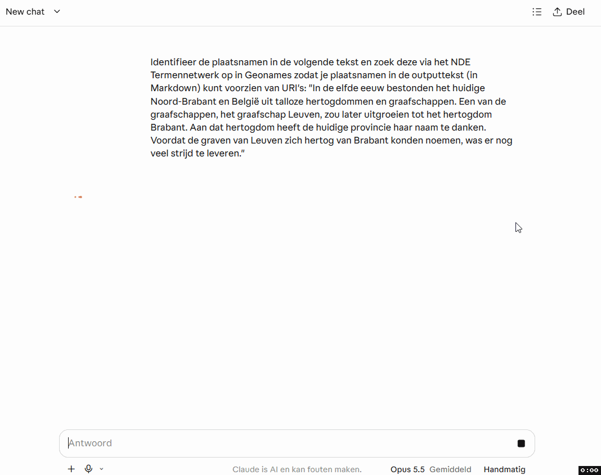

# NDE Network of Terms MCP server

An [MCP](https://modelcontextprotocol.io) server for the
[Network of Terms](https://termennetwerk.netwerkdigitaalerfgoed.nl/) (Termennetwerk) of the Dutch
Digital Heritage Network (NDE). It lets AI assistants search, look up and reconcile cultural
heritage terminology: AAT, Cultuurhistorische Thesaurus (CHT), RKDartists, GTAA, NTA, GeoNames,
Wikidata, Iconclass, WO2-thesaurus and about fifty more sources.

- Public endpoint (Streamable HTTP, stateless, no authentication): `https://mcp-termennetwerk.coret.org/`
- Upstream API: `https://termennetwerk-api.netwerkdigitaalerfgoed.nl/` ([docs](https://docs.nde.nl/services/network-of-terms/))
- Not an official NDE service.



*Example in claude.ai: place names in a Dutch text about medieval Brabant linked to GeoNames URIs.*

## Use it

Endpoint: `https://mcp-termennetwerk.coret.org/` (Streamable HTTP, no authentication).

**claude.ai / Claude Desktop**: Settings, Connectors, *Add custom connector*, URL
`https://mcp-termennetwerk.coret.org/`.

**Claude Code**:

```bash
claude mcp add --transport http termennetwerk https://mcp-termennetwerk.coret.org/
```

**ChatGPT**: open [chatgpt.com/plugins](https://chatgpt.com/plugins), select **+**, *Add custom MCP
server*, enter a name and the *Server URL*, choose *No authentication*, confirm the risk warning and
select *Create as a plugin*. Install the plugin and select it with `@` in the prompt box. In Business
or Enterprise workspaces an admin may have to allow custom MCP servers.

**GitHub Copilot (VS Code)**: Command Palette, *MCP: Add Server*, *HTTP*, the URL above, ID
`termennetwerk`. Or in `.vscode/mcp.json` (workspace) or the user `mcp.json`:

```json
{
  "servers": {
    "termennetwerk": {
      "type": "http",
      "url": "https://mcp-termennetwerk.coret.org/"
    }
  }
}
```

**Microsoft Copilot Studio**: in your agent, *Tools*, *Add a tool*, *New tool*, *Model Context
Protocol*; enter a name, description and the URL above, authentication *None*, *Create*, then *Add to
agent*.

Any other MCP client that supports Streamable HTTP works the same way. Example prompts:

- "Which Network of Terms sources cover materials? Find the AAT and CHT terms for *glas*."
- "Find the RKDartists URI for Rembrandt, born 1606."
- "Give me the broader terms and English labels of `http://vocab.getty.edu/aat/300010855`."

## Tools

| Tool | What it does |
|---|---|
| `list_sources` | Lists the terminology sources with name, description, genres, languages, availability and reconciliation URL. Filter by genre; metadata in `nl` or `en`. |
| `search_terms` | Searches up to 10 sources for a text query. Per source: `ok`/`error`, `total`, and the best terms (exact label matches first) with labels, definitions, hierarchy, `exactMatch` links and place/person/organization details. |
| `lookup_terms` | Resolves up to 200 known term URIs to the same compact term structure. Unknown URIs come back with `ok: false`. |
| `reconcile` | Matches up to 10 names against one source (W3C Reconciliation API) with scores, `match` and optional person properties (birth/death dates and places, parents, spouses, occupations, ...). |
| `extend_terms` | Fetches selected properties (26 available, e.g. `prefLabels`, `broaderTerms`, `birthDates`, `latitudes`) for up to 100 term URIs. Unknown URIs are listed in `notFound`; rows left out for size are listed in `omitted`. |

All tools are read-only (`readOnlyHint: true`). Each returns compact JSON as text and as
`structuredContent`.

## Mapping to the upstream API

| Tool | Upstream call | Argument mapping | Result mapping |
|---|---|---|---|
| `list_sources` | GraphQL `sources(genres)` | `language` becomes the `Accept-Language` header | `features` become `reconciliationUrl` and `supportsGenreFilter`; `status` becomes `available` and `lastChecked`; `creators` and `genres` become name lists |
| `search_terms` | GraphQL `terms(sources, query, genres, languages, queryMode, timeoutMs)` | source names are resolved to URIs; `limit` is **not** sent (see design decisions) | union `Terms \| TranslatedTerms \| TimeoutError \| ServerError` becomes `{ok, error?, total, terms}` per source |
| `lookup_terms` | GraphQL `lookup(uris, languages, timeoutMs)` | duplicate URIs removed | union `Term \| TranslatedTerm \| NotFoundError \| ...` plus `Source \| SourceNotFoundError` becomes `{uri, ok, source?, error?, term?}` |
| `reconcile` | `POST {source.features[RECONCILIATION].url}`, form field `queries` | array becomes `{"q0": ..., "q1": ...}`; `language` becomes `Accept-Language` | candidates get `type` as a list of URIs, a guaranteed non-empty `name`, and a `match` flag (upstream's own value, otherwise `score >= 100`) |
| `extend_terms` | `POST /extend`, form field `extend` | `properties` becomes `[{id}]` | `rows` values become strings or `{id, name}`; missing ids become `notFound` |

Term output: `uri`, `prefLabel`, `altLabel`, `hiddenLabel`, `definition`, `scopeNote`, `seeAlso`,
`broader` / `narrower` / `related` / `exactMatch` (`{uri, label}`), `place` (`name`, `latitude`,
`longitude`, `addressCountry`), `person` (`givenName`, `familyName`, `birthDate`, `deathDate`,
`birthPlace`, `deathPlace`, `occupations`, `nationality`, `gender`, `parent`, `children`,
`spouse`, `sibling`) and `organization` (`type`, `foundingDate`, `dissolutionDate`, `location`,
`parentOrganization`). Empty fields are omitted. Labels are string lists, or a language map
(`{"nl": [...], "en": [...]}`) when `languages` is given.

## Design decisions

- **Own TypeScript server** (Express, MCP SDK, zod) instead of a generic GraphQL-to-MCP bridge:
  reconciliation is not GraphQL, and raw GraphQL unions are hard for a language model to read.
- **Stateless Streamable HTTP**: a fresh MCP server per request, JSON responses
  (`enableJsonResponse`), no sessions. Mounted on `/` and `/mcp`.
- **`limit` is applied by this server, not upstream.** Upstream applies `limit` inside the SPARQL
  query *before* ranking, and some sources return alphabetical order: with `limit: 3` RKDartists
  does not return Rembrandt himself (`artists/66219`). The server always fetches the upstream
  default (100), re-ranks (exact prefLabel, prefLabel prefix, exact altLabel, contains, rest;
  accent- and case-insensitive; upstream order breaks ties) and then cuts to `limit` (default 20).
- **Sources by name or URI.** Language models know names better than URIs. Names are matched
  case-insensitively against `name` and `alternateName`, in Dutch and English; unknown names give an error with
  suggestions and a pointer to `list_sources`.
- **Byte budget.** The JSON payload of every response stays under 60 000 bytes (it is sent twice,
  as text and as `structuredContent`). When trimmed, the response has `truncated: true` and a
  `note` that tells the model how to narrow the request; `extend_terms` lists dropped rows in
  `omitted`.
- **Caching** in Redis (`tn:` prefix): sources and search 1 h, lookup and extend 24 h, reconcile
  1 h. Results containing any per-source error are never cached. Without Redis the server runs
  uncached (the source list is also kept in memory for 1 h).
- **Load protection.** At most 10 sources per search, 200 URIs per lookup, 10 reconcile queries,
  100 extend ids; 60 `tools/call` requests per minute per IP (other JSON-RPC methods are not
  counted); JSON-RPC batch arrays are rejected (MCP dropped batching in protocol 2025-06-18), so
  every tool call passes the limiter; outgoing requests are spaced at 10 per second.
- **Privacy.** The application log records tool name, item count, duration, cache hit and error
  class. It never records query text, URIs or IP addresses, also not for malformed request
  bodies (those get a JSON-RPC `-32700` answer).
- **Origin check** against DNS rebinding: requests without `Origin` (native clients) and from
  `claude.ai` / `claude.com` are allowed; add more with `ALLOWED_ORIGINS`.
- **Types generated from the live schema** (`npm run codegen`), because the `Language` enum is
  built from the catalog when upstream starts.

## Observations on the upstream API

Checked against the live API on 2026-11-17.

- `terms.limit` is applied before ranking (see above); results of some sources are alphabetical.
- Passing `languages` changes the result type from `Terms` to `TranslatedTerms` (labels become
  `{language, value}`). Term and TranslatedTerm share field names with different types, so a
  query that selects both in one union needs aliases.
- `Language` is `en | fy | nl`. Asking for `fy` only gives mostly empty labels.
- `timeoutMs` above 60000 is a GraphQL error. The AAT regularly needs more than the 10 s default.
- Reconciliation with `Accept-Language: en` returns empty `name` values for some sources (RKD);
  the description still carries the labels.
- Reconciliation queries in one batch run sequentially upstream.
- The reconciliation URL of sources whose URI has a fragment (AAT subsets, Canon van Limburg)
  is already percent-encoded (`%23`) in `features.url`.
- Upstream sets `match` itself only for queries with properties.
- `extend` silently leaves out ids it does not know.
- The documentation lists `exactMatches` as a Term field; the schema field is `exactMatch`.
  The documentation does not mention `terms.limit` or `Term.person`.

## Development

Requires Node.js 22 or later (developed on 24).

```bash
npm install
npm test            # unit tests on recorded fixtures (no network)
npm run dev         # run from source on PORT (default 3004)
npm run build       # compile to dist/
npm run codegen     # regenerate GraphQL types from the live schema
npm run record      # re-record tests/fixtures/ from the live API
```

Environment: `PORT` (3004), `REDIS_URL` (`redis://localhost:6379/9`, empty string disables),
`ALLOWED_ORIGINS` (comma separated), `RATE_LIMIT_PER_MIN` (60), `UPSTREAM_RPS` (10),
`TN_API_BASE`, `LOG_LEVEL`.

## Deployment

The public instance runs behind Apache:

- `start.sh` is started by supervisor (`[program:termennetwerk-mcp]`), listening on
  `127.0.0.1:3004`.
- Apache vhost `mcp-termennetwerk.coret.org` proxies to it with `ProxyTimeout 180`.
- `GET /health` returns `{status, version, redis}`; files in `public/` (landing page assets) are
  served as static files.

## Discovery metadata

| Path | Content |
|---|---|
| `/.well-known/mcp/server-card.json` | MCP Server Card (SEP-1649), from `well-known/mcp-server-card.json` |
| `/.well-known/mcp.json` | alias of the server card |
| `/.well-known/agent-card.json` | A2A v0.3 Agent Card, from `well-known/agent-card.json` |
| `/.well-known/agent.json` | alias of the agent card |

`server.json` in the repository root is the MCP registry entry. When the version changes, update it
in `package.json`, `server.json` and both cards.

## Validation recipe

1. `npm test` and `npm run build` succeed.
2. `curl -s https://mcp-termennetwerk.coret.org/health` shows `"status":"ok"` and `"redis":true`.
3. With the MCP Inspector (`npx @modelcontextprotocol/inspector`, Streamable HTTP, the URL above):
   - `search_terms` `{"sources":["RKDartists"],"query":"Rembrandt","limit":3}`: first term is
     `https://data.rkd.nl/artists/66219`.
   - `search_terms` on `http://vocab.getty.edu/aat`, query `glas`, `languages: ["nl","en"]`,
     `timeoutMs: 45000`: labels come as a language map.
   - `lookup_terms` with a CHT URI and `https://example.org/nope`: second item `ok: false`.
   - `reconcile` `{"source":"RKDartists","queries":[{"query":"Rembrandt","properties":[{"pid":"birthDates","v":"1606"}]}]}`:
     top candidate 66219, score 100, `match: true`.
   - `reconcile` on `Wikidata: alle entiteiten`: error pointing to `search_terms`.
   - `extend_terms` for 66219 with `prefLabels`, `birthDates`: `["Rembrandt"]`, `["1606-07-15/1607"]`.
4. The same call twice: the second is logged with `"hit":true`.

## Not yet working / known limits

- Tested end-to-end with claude.ai and Claude Code only. The ChatGPT, GitHub Copilot and Copilot
  Studio steps follow the vendors' documentation (November 2026) but have not been verified here yet.
- No stdio transport: the server is meant to be used remotely.
- No pagination: `search_terms` returns at most 100 terms per source (upstream maximum).
- Reconcile does not expose the `/suggest` and `/preview` endpoints.
- Not yet listed in the MCP registry.

## Roadmap

- [ ] Publish `server.json` to the MCP registry.
- [ ] Optional stdio entry point for local use.
- [ ] Dutch translation of this README.
- [ ] Use `/suggest/property` to keep the reconcile property list in sync automatically.
- [ ] Add `view` / `preview` links of the reconciliation service to candidates.

## Links

- [Termennetwerk](https://termennetwerk.netwerkdigitaalerfgoed.nl/nl): the Network of Terms of the Dutch Digital Heritage Network (NDE)
- [termennetwerk-api.netwerkdigitaalerfgoed.nl](https://termennetwerk-api.netwerkdigitaalerfgoed.nl/): upstream GraphQL and Reconciliation API
- [NDE documentation](https://docs.nde.nl/services/network-of-terms/) of the Network of Terms
- [Video: Help AI met jouw erfgoedservices (via MCP)](https://www.youtube.com/watch?v=ZjEx1gW5_ws) (Dutch)
- [mcp-termennetwerk.coret.org](https://mcp-termennetwerk.coret.org/): the public instance and its landing page
- [mcp.openarchieven.nl](https://mcp.openarchieven.nl/): sister MCP server for Open Archives (Dutch genealogical records and transcriptions)

## License

[EUPL-1.2](LICENSE), the same license as the
[Network of Terms](https://github.com/netwerk-digitaal-erfgoed/network-of-terms) itself.
